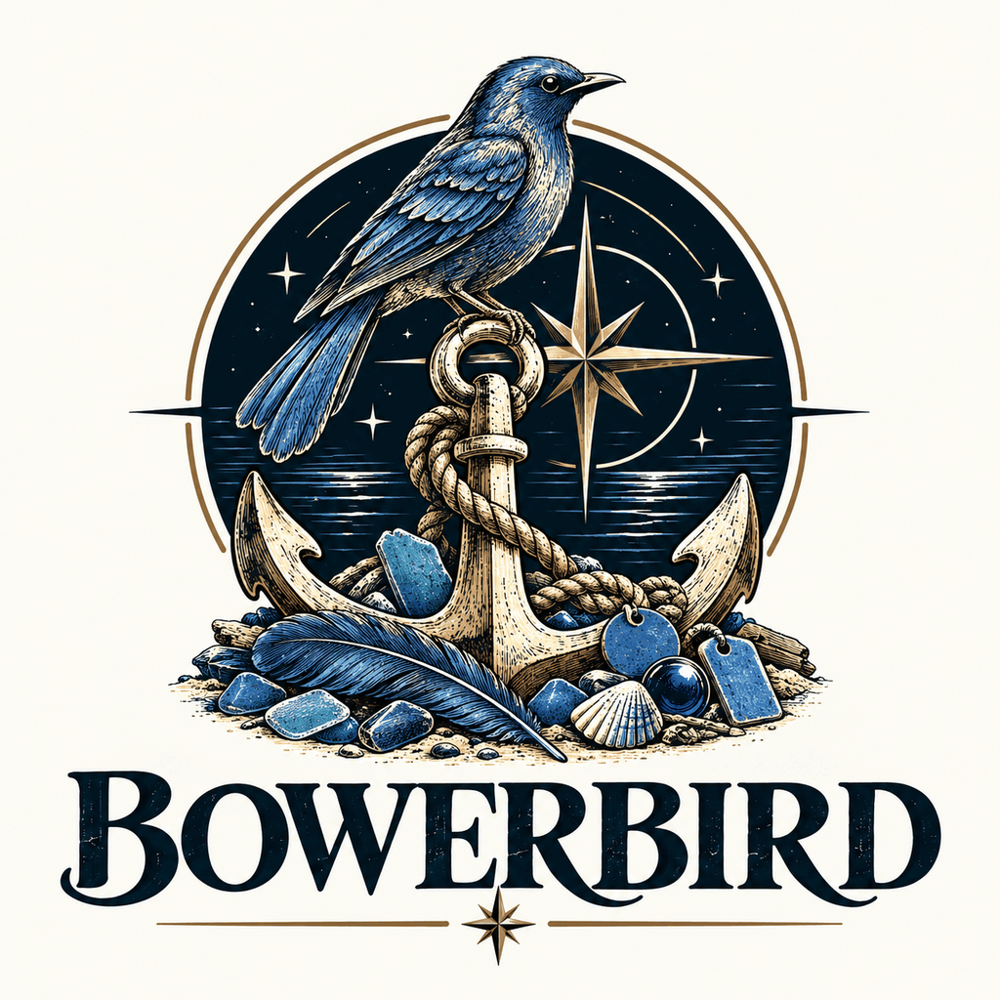
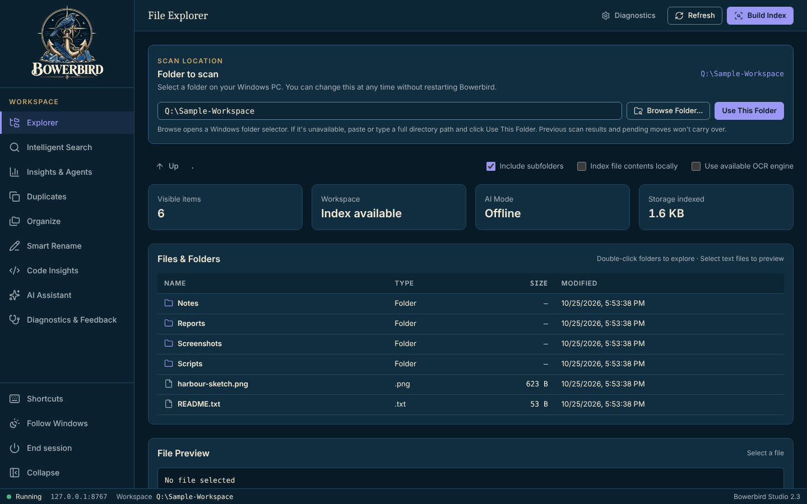
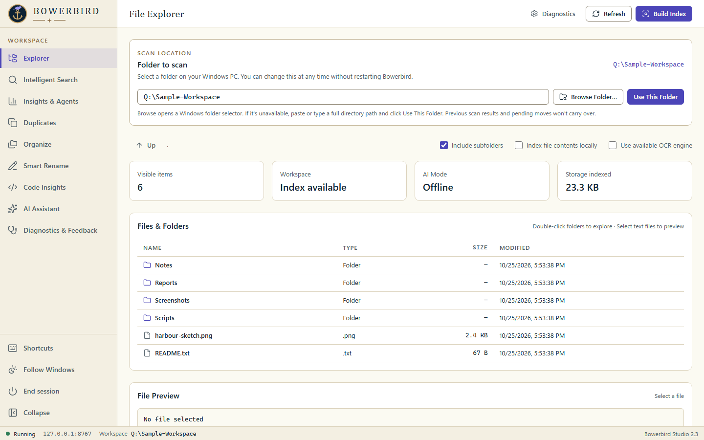

<p align="center">
  <picture>
    <source media="(prefers-color-scheme: dark)" srcset="assets/brand/emblem-dark.png">
    
  </picture>
</p>

# Bowerbird Studio

**Local-first file intelligence and screenshot renaming for Windows PowerShell 5.1 and your existing web browser.**

[Windows PowerShell CI](https://github.com/fleethacker-data-crucible/Bowerbird/actions/workflows/windows-powershell.yml) · [Source](https://github.com/fleethacker-data-crucible/Bowerbird/tree/main)

No Python, Node, npm, Git executable, or admin-installed package is required on the target workstation. The development pipeline uses Node only to check syntax on GitHub-hosted Windows runners.

## The name

A *bower* is a ship's main anchor, the one carried at the bow (sailors call it the best bower). The bowerbird is the bird that collects small treasures and arranges them with care. Bowerbird does the same for your files: it gathers screenshots and documents, works out what they are, and puts them in order.

| Night watch (dark) | Chart room (light) |
| --- | --- |
|  |  |

Studio follows the Windows light/dark setting; the theme button in the sidebar switches between Follow Windows, Night watch and Chart room. The screenshots show a throwaway folder of invented sample files.

## Start: the GUI, not the legacy CLI

**Double-click Start-Bowerbird.bat**. This is the supported GUI launcher, modeled on Lazarette/Halyard's PowerShell 5.1 -STA, -NoProfile, process-scoped execution settings and browser-native architecture. It opens **Bowerbird Studio**, not the old renamer.

The second and only other BAT launcher is Start-Bowerbird-Console.bat for the original screenshot-renaming CLI.

Start-Bowerbird-Console.bat also runs every Studio action as a named command for scripts and agents, such as `Start-Bowerbird-Console.bat index search --query invoice --json`. `commands --json` lists them all. See [docs/CLI.md](docs/CLI.md).

To select a workspace:

    Start-Bowerbird.bat -Root "C:\Users\YOURNAME\Documents\Screenshots"

If none is supplied, Studio tries Pictures, Documents, the user profile, and finally the current directory. The folder must exist. **The workspace is never created or modified at startup.**

For safe launch diagnostics:

    Start-Bowerbird.bat diagnostics

To start the server without opening a browser:

    Start-Bowerbird.bat -Root "C:\TestWorkspace" -NoBrowser

Copy the Session URL from PowerShell into your browser. It contains a private ephemeral token; don't share it in logs or screenshots. If automatic browser opening is blocked, the backend remains available and prints the manual session URL.

### Stopping Studio

The browser tab owns the server. Close the tab and the PowerShell server stops itself (5 seconds after the tab leaves, or 20 seconds after the last heartbeat if the browser crashed). A reload or a second open tab keeps it running, and it never stops while a request such as indexing, apply or AI is still running.

- **End session** at the bottom of the sidebar stops the server now.
- `Stop-Bowerbird.ps1` stops every running Studio from a shell, including a hidden or forgotten window. No PID needed.
- Starting Studio while one is already running asks *Stop it and start fresh?* `--replace` (or `-Replace`) answers yes without asking.
- `--stay` (or `-Stay`) keeps the server running after the tab closes. `BOWERBIRD_AUTO_STOP=0`, as an environment variable or in `Config\bowerbird.env`, does the same for every launch.

    Start-Bowerbird.bat --stay
    Start-Bowerbird.bat --replace
    powershell.exe -NoProfile -File .\Stop-Bowerbird.ps1

Each running server writes `%LOCALAPPDATA%\Bowerbird\Logs\bowerbird-server-<pid>.json` (pid, port, URL and start time; never the session token) and deletes it when it stops. Those files are how the launcher and `Stop-Bowerbird.ps1` find it; files left by a crashed server are removed the next time either one runs. `-NoBrowser` sessions never auto-stop until a browser tab has connected.

### Change the scan folder inside the GUI

You no longer have to restart PowerShell or use the command line to select a new folder:

1. Open **Start-Bowerbird.bat** and stay in the **Explorer** screen.
2. In **Folder to scan** at the top, click **Browse Folder…** and select a directory using the native Windows picker.
3. If the native picker is unavailable on the workstation, paste a full path into the same field and click **Use This Folder**.
4. The Explorer immediately switches to that directory. Click **Build Index** to scan it and optionally include its subfolders.

Selecting a folder is **not the same as scanning it**: an index is built only when the user explicitly clicks **Build Index**. Changing folders clears the current browser preview and pending move approval. Indexed contents and undo journals are stored separately per workspace in the user-local Bowerbird State folder, so results from different folders do not mix. You can return to a previously indexed folder; its index may still be available, but pending move plans must be regenerated.

The native picker uses the built-in Windows Forms folder dialog from the current interactive PowerShell session. If it is blocked by workplace restrictions or appears behind the browser, use the path-entry fallback. Browser upload controls cannot expose full local paths to a server for security reasons.

### Ports and workstation compatibility

Normal startup uses **pure Windows PowerShell 5.1 with .NET TcpListener on 127.0.0.1**. No C# compilation, HTTP.sys URL reservation, administrator privileges, Node, Python, or external web-server installation is required. It prefers local port **8767**, and when another app owns that port, binds an available OS-assigned port and prints/opens the actual URL. This follows Lazarette's auto-port approach.

    Start-Bowerbird.bat -Port 8800

-Port 0 always selects an available port. -FixedPort fails rather than switching ports. -Transport HttpListener and -Transport CompiledTcp remain available as opt-in development alternatives but are not needed for GUI launch. Process-scoped execution settings cannot override enforced Group Policy, AppLocker or WDAC rules.

### Diagnostics and troubleshooting

Startup failures remain visible in the BAT window. The browser has a **Diagnostics** button displaying safe UI button identifiers, API response codes and startup errors. Local logs live under:

    %LOCALAPPDATA%\Bowerbird\Logs

Indexes, journals and pending plans are now isolated by folder under:

    %LOCALAPPDATA%\Bowerbird\State\workspaces

Those paths avoid writing to a possibly read-only installation folder. Logs omit request bodies, image contents, credentials and token query strings. Review diagnostics before sharing.

Run Start-Bowerbird.bat diagnostics when the GUI doesn't start. It checks required files, PowerShell parsing, a local loopback socket, state-folder writability, and effective policy without changing policy.

## Diagnostics & Feedback (from Halyard)

Open **Diagnostics & Feedback** in the left sidebar (or the Diagnostics shortcut in the top bar).

1. Click **Start Recording**, reproduce the failure, then click **Stop**. The session recorder captures button IDs, page transitions, local HTTP status and timing; it does not collect typed values, file contents, AI prompts or credentials.
2. Click **Mark Last Action Not Working** to prefill the affected feature, or complete the **Log an Error or Broken Feature** form yourself. Provide what happened, what you expected, and steps to reproduce.
3. Click **Save Local Issue Report**. Each report gets a unique ID, stays in your user-local Issues folder, and can be marked resolved/reopened.
4. Use **Refresh Logs** for sanitized backend errors correlated by request ID, or **Run Checks** for local readiness without contacting external services.
5. Click **Download Support Bundle** to export an editable JSON report. Free-text issue notes are **excluded by default**; only select **Include descriptions** when you expressly want to include the words you typed. Review all exports before sharing.

Automatic browser exceptions, rejected promises and unsuccessful local API requests are captured even if session recording is off. Full action recording is opt-in and memory-only. Support bundles are downloaded locally; nothing is uploaded or emailed. The source issue files live under:

    %LOCALAPPDATA%\Bowerbird\Logs\Issues

Server logs live under:

    %LOCALAPPDATA%\Bowerbird\Logs

If the GUI will not launch at all, run `Start-Bowerbird.bat diagnostics`. See [Diagnostics and feedback guide](docs/DIAGNOSTICS.md) for troubleshooting workflows.

## What is implemented

| Area | Functionality |
| --- | --- |
| Explorer | Native GUI folder selection, manual full-path selection, folder navigation, metadata and safe previews |
| Smart Rename | Screenshot/image analysis using metadata and filename patterns, optional AI vision, preview, consented apply, undo |
| Smart Index | SHA-256, image dHash, categories, metadata, optional full-text and optional OCR |
| Search | BM25-inspired token scoring with cached per-document frequencies, file name boost |
| Related Files | Local Jaccard-style lexical similarity for discovering related indexed files |
| Duplicates | Exact SHA-256 groups and near-duplicate image hash groups |
| Organization | JSON rules for extensions, names, content and file sizes, collision reporting, approval before applying |
| Journaling | Per-step durable journal, archive of previous runs, source hash preconditions and checked undo |
| Insights | Category inventory, indexed bytes, duplicate groups, extraction failures |
| Local Agents | Read-only organization, duplication, and index-quality analysis; usable without cloud AI |
| AI Chat | Optional Lazarette/AI endpoint/Grok integration, streamed browser output when provider supports SSE; fallback JSON responses |
| Code Insights | Language and line statistics by extension |
| Diagnostics & Feedback | Halyard-style session recorder, automatic browser/API errors, local issue reporting and resolution, request IDs, health checks, redacted support export |\n| Tests | Windows PowerShell parser check, JavaScript/DOM contract tests, smoke and real localhost HTTP API tests on both transports |

### Important implementation distinctions

- **PDF**: Browsing works through the browser's native PDF viewer. Local PDF text extraction is best-effort for uncompressed and FlateDecode text streams; this is **not** a full PDF parser.
- **OCR**: If an approved `tesseract.exe` is already available on PATH, enable OCR when indexing. Nothing is auto-installed.
- **AI vision**: The legacy CLI now requires `-AllowVision` and Studio requires both `-AllowCloudAI` and a separate explicit vision consent. No images are uploaded by ordinary indexing or local rename preview.
- **Streaming**: The SSE bridge supports compatible providers; endpoints which decline streaming may return a complete JSON response. Model authentication still needs working approved credentials / Lazarette integration.
- **Agents**: The local agents are deterministic and read-only. They are not autonomous LLM tool-call agents.
- **Search**: Related-file matching is lexical, not neural embeddings. There is no on-device LLM included.

### AI endpoint configuration

> **Intelligence router:** these endpoints will move behind the Fleet intelligence router, [Fairlead](https://github.com/fleethacker-data-crucible/Fairlead), so Bowerbird defaults to the router (which picks local phoenix-lai or a remote provider) instead of a fixed endpoint. Until then the settings below stay as they are. See [TechStack](TechStack), "Intelligence router".

AI Chat and the second naming pass default to the local phoenix-lai server's OpenAI-compatible API on this PC, `http://127.0.0.1:1234/v1/chat/completions`, with model `phoenixlai` (whichever model phoenix-lai has loaded). Set these in `Config\bowerbird.env` to change it:

| Variable | Profile | Default | Notes |
| --- | --- | --- | --- |
| `BOWERBIRD_AI_ENDPOINT_URL` | AiEndpoint | `http://127.0.0.1:1234/v1/chat/completions` (local phoenix-lai) | Full chat-completions URL. Overrides the default when set. |
| `BOWERBIRD_GROK_URL` | Grok | none | Outside provider, so no URL is built in. Required for the Grok profile. |
| `LLM_URL` | any | none | Shared override (legacy alias): wins over both variables above. |
| `LLM_MODEL` | any | `phoenixlai` on the local default, otherwise the profile's model | Set it when an override URL needs a specific model name. |
| `AI_ENDPOINT_TOKEN` / `LLM_TOKEN` | AiEndpoint / any | none | Optional for a local (loopback) endpoint: phoenix-lai's API key is off by default, and no `Authorization` header is sent without a token. Required for a remote endpoint, where Lazarette is also tried. |

## Recommended workflows

**Explore and search**: Launch with a disposable or approved workspace, click *Build Index*, optionally enable content indexing, then use Search, Duplicates, or Insights & Agents.

**Rename screenshots**: Open the target folder in Explorer, select *Smart Rename*, optionally enable approved AI vision, then *Generate Rename Proposals*. Review the confidence and destination of each proposal before entering `APPLY`.

**Organize files**: Edit the JSON rules in *Organize*, generate a plan and inspect every proposed move. `APPLY` is required to modify files. The *Undo Last Apply* button checks source/destination and checksum preconditions before restoration.

**Legacy CLI**:

```powershell
powershell.exe -NoProfile -File .\Start-BowerbirdMVP.ps1 -Path "C:\TestImages"
powershell.exe -NoProfile -File .\Start-BowerbirdMVP.ps1 -Path "C:\TestImages" -AllowVision -MaxVision 5
powershell.exe -NoProfile -File .\Start-BowerbirdMVP.ps1 -Path "C:\TestImages" -Apply
```

The default CLI behavior is preview-only and offline. Use cloud vision only on data approved for the selected endpoint.

## Testing

```powershell
powershell.exe -NoProfile -File .\Tests\Smoke.ps1
powershell.exe -NoProfile -File .\Tests\Lifecycle.ps1
powershell.exe -NoProfile -File .\Tests\StudioIntegration.ps1
```

GitHub Actions checks PowerShell and JS/DOM syntax, startup prerequisites, both HTTP transports, port collisions, the real GUI BAT launcher, and Edge rendering when available. Windows-hosted CI cannot establish behavior under every managed workstation policy. The Studio integration test exercises authentication, changing the scan folder, per-folder index isolation, stale plan invalidation, indexing, search, duplicate discovery, local agents, planning, apply, undo and path rejection without any AI token.

## Privacy, safety and operations

- No endpoint workaround or privilege escalation. Use only software/network paths authorized for your workstation.
- Cloud AI is disabled unless launched with `-AllowCloudAI`. Only send content authorized for the configured destination.
- API endpoints require a cryptographically generated session token, reject foreign browser origins and bind to `127.0.0.1`. Do **not** expose the service with proxies or port forwarding.
- The index may contain **plaintext extracted documents** in `Data/studio-index.json` when content indexing is enabled. `Data/` is ignored by Git.
- The journal archives previous move runs in `Data/history/`. It is not an ACID filesystem transaction and does not guarantee rollback on power loss. Keep backups of important data and test rules on copies first.
- File access is constrained to the selected workspace, with API path checks and reparse-point protections. Review local endpoint policy before handling sensitive workloads.

For the standalone intelligence CLI see [README_INTELLIGENCE.md](README_INTELLIGENCE.md). For original renamer usage see [README_MVP.md](README_MVP.md).
