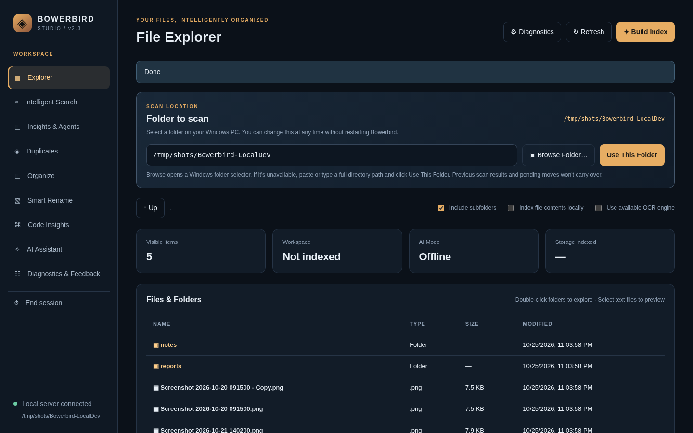
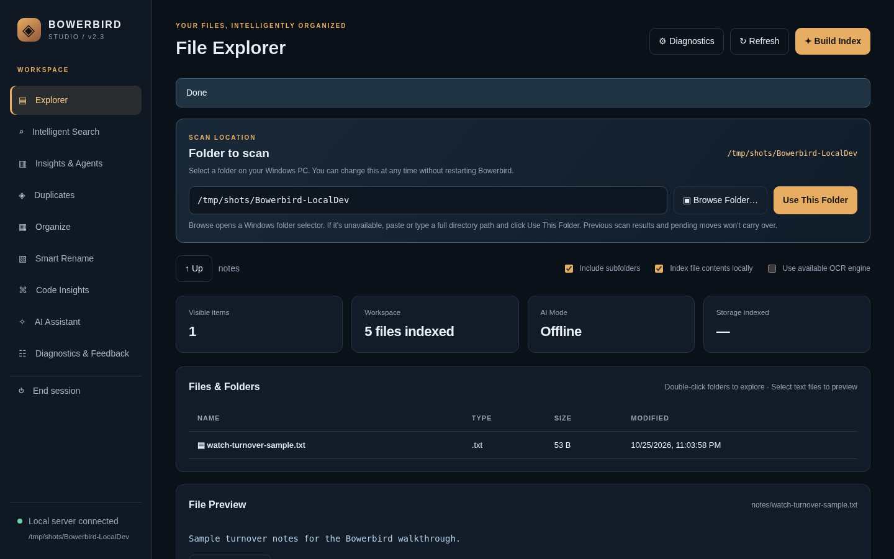
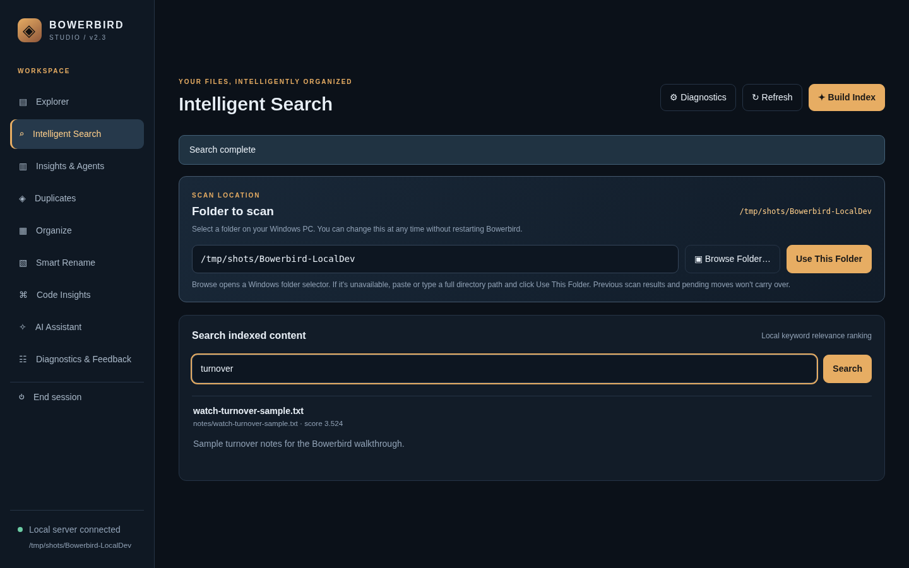
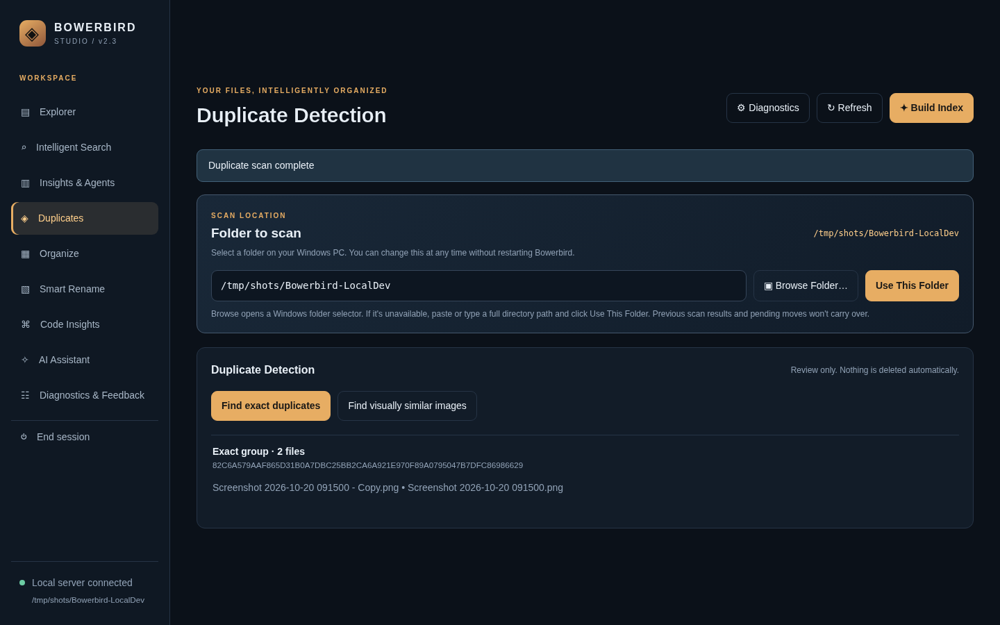
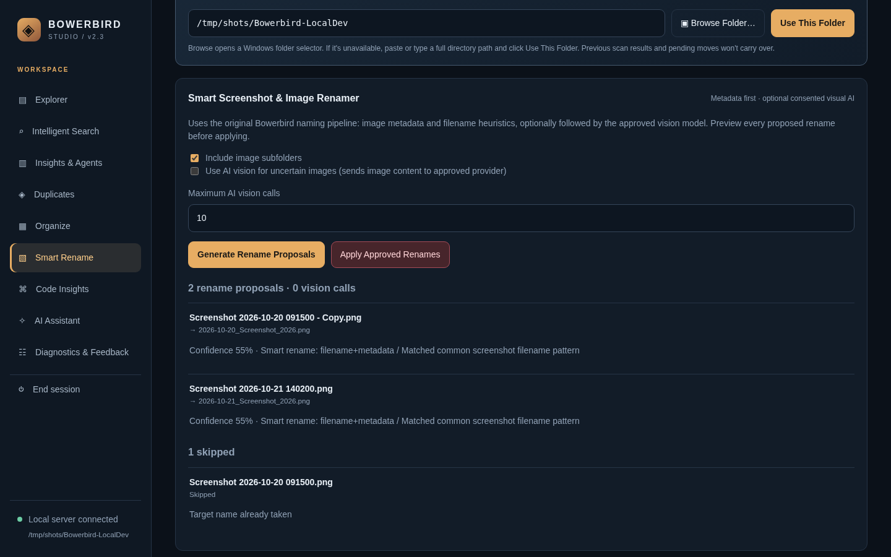
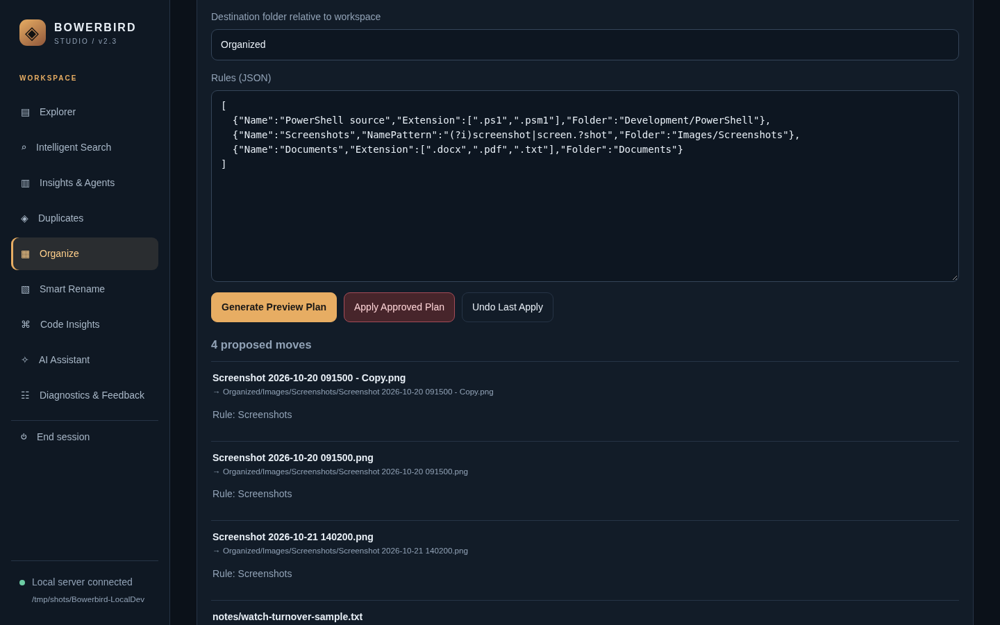
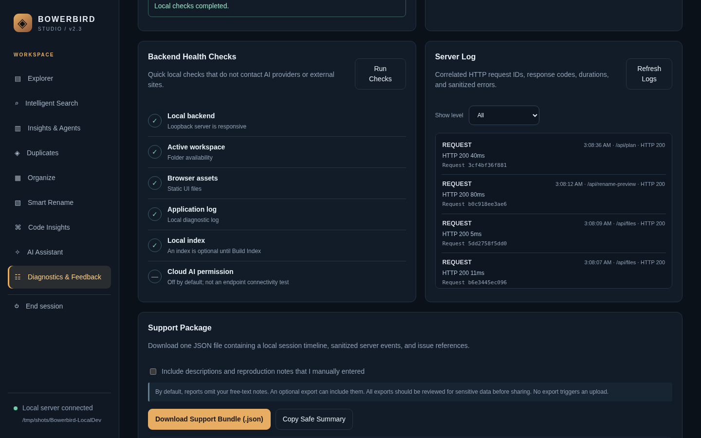

# Bowerbird walkthrough

Index a folder, find duplicates, and rename and organize files from reviewed proposals that change nothing until you type APPLY.

> **Screenshots:** captured with demo data and scanned by the Chief of Staff (team directive 10).

## Before you start

- Windows PowerShell 5.1 (part of Windows). No administrator rights and no installer.
- Microsoft Edge or Google Chrome.
- Launch: Double-click `Start-Bowerbird.bat` (or `Start-Bowerbird.bat -Root "C:\TestWorkspace"` to pick the folder to scan).
- A disposable or approved folder to scan.

## Steps

### 1. First launch

Bowerbird Studio opens on **File Explorer**. Enter the folder to scan and select **Use This Folder**. The files and folders appear, not yet indexed.

### 2. Build the index

Select **Build Index**. Files and folders appear with a preview of the selected file.

### 3. Search

**Search** finds indexed files by name, and by content if you turned content indexing on.

### 4. Find duplicates

**Duplicates** groups identical files.

### 5. Rename screenshots

**Smart Rename** proposes new names with a confidence for each. Files it cannot rename are listed as skipped. Nothing changes until you select **Apply Approved Renames** and type `APPLY`.

### 6. Organize by rules

**Organize** turns JSON rules into a move plan you inspect before applying. **Undo Last Apply** reverses it.

### 7. Check health

**Diagnostics** runs backend health checks and builds a support package.

*Times in the server log are in UTC.*

## About these images

Images live in [`docs/assets/walkthrough/`](../assets/walkthrough/), named `NN-<screen>.png` after the step they belong to. They are 1440x900 at 100% scale in the Dark (Bowerbird has one theme) theme, and show demo data only.
